# 智域协同（LanMind）

> 最新已发布版本：v0.2.1 · Tauri 2 · React 19 · SQLite

智域协同是一款面向办公室、项目现场和隔离内网团队的本地优先协作桌面应用。它把工作区、项目、任务、Wiki、AI 助手、沟通、文件传输和桌面日历集中在一个跨平台（Windows / macOS / Linux）客户端中，通过局域网直接连接团队成员，不依赖中心业务服务器。

每台设备都保存自己的本地数据。即使暂时离线，成员仍可查看和维护已有任务；设备重新出现在局域网后，应用会继续交换授权范围内的增量变更。需要智能对话、任务解析、文件处理或工作汇报时，可以按需连接 Ollama、vLLM、SGLang 或 OpenAI 兼容模型服务。

## v0.2.1 发布摘要

`v0.2.1` 是一次全面的功能与架构升级版本，聚焦统一工作台、Wiki 知识库现代重构、多模型本地智能体 (AI Agent)、项目协作分栏升级、数据清理与任务回收站体验。版本元数据已同步到前端、Tauri 和 Rust 工程配置。

- **统一工作台与全局快捷键**：新增全局模块导航、Work/Wiki/AI/Chat/光学传输/设置入口、`Ctrl/Cmd+K` 命令面板及上下文抽屉。
- **工作区隔离**：任务、Wiki、聊天、文件、通知和同步按工作区归属；个人会话、收藏和视图再按用户区分，外部 MCP/Web 授权固定所属工作区。
- **项目协作与组织架构**：成员管理与组织架构左右分栏、一键全选/折叠，群组关联协作项目并一键同步成员；支持项目归档与排期管理。
- **任务卡片与编辑器**：我的任务和协作项目统一为卡片列表，展示状态、优先级、负责人、排期、提醒、进度、标签和创建/更新信息，支持标准/紧凑密度及展开子任务、检查事项和附件；新建与编辑表单适配窄屏。
- **任务回收站与安全防误删**：删除任务统一确认弹窗，删除后自动移入回收站保留 30 天，支持多条件检索、只读详情预览、单项恢复与整组恢复。
- **Wiki 知识库重构**：页面树、搜索、Markdown 编辑与预览、项目关联、收藏、锁定与 ZIP 导出；Notion/Obsidian 现代排版、Draft 缓存流畅编辑、版本历史与恢复。
- **多模型与本地智能体 (Agent)**：多连接、多模型分组、用途默认值、多轮流式对话、停止与版本切换；Skills、MCP 客户端、目录授权、文件审批、结构化追问卡片 (Ask User) 与任务/Wiki 转化。
- **系统设置与本地数据清理**：在系统设置中支持按类别（任务、Wiki、聊天、AI 对话）多选或全选清理，支持当前工作区与全部数据范围选择，具备防误触口令二次安全确认。
- **两套主题与视觉统一**：收敛为亮色、暗色与跟随系统，旧主题设置自动映射；任务状态和优先级使用统一语义颜色。

桌面安装包和校验说明见 [GitHub Releases 的 v0.2.1](https://github.com/bspeng922/lanmind/releases/tag/v0.2.1)；升级前请阅读 [发布说明](CHANGELOG.md#v021---2026-10-22)。

---

## 历史版本回顾 (v0.2.0)

`v0.2.0` 聚焦国际化、聊天协作效率、桌面端可用性和跨平台回归验证。
- **中英文国际化**：支持简体中文、英文和跟随系统，主窗口、附属窗口、托盘、网络访问和离线接收端共用语言资源。
- **聊天截图**：桌面客户端可框选屏幕、复制到剪贴板或另存为 PNG，也可隐藏主窗口后截图并直接粘贴到聊天输入框。
- **聊天协作**：群聊支持 `@` 成员提醒、任务引用和更清晰的输入交互。
- **任务工作流**：任务详情支持上下条目切换，更多操作集中到统一菜单，列表、日历和看板的排序筛选保持一致。
- **桌面与安全**：完善关闭按钮行为、自动锁定、网络伺服、日历挂件和通知窗口在不同显示器工作区的处理。

---

## 适用场景

- 同一办公室或园区网络内的小型团队协作
- 无法使用公有云、需要本地保存业务数据的内网环境
- 临时项目组、交付现场和跨设备任务协同
- 希望把任务事实快速整理成日报、周报、月报和汇报 PPT 的团队

---

## 界面预览

以下为核心界面与最新功能预览截图，覆盖现代任务卡片、Notion 风格知识库、多模型智能体追问、多级组织架构及安全回收站等模块。

### 1. 看板视图（Kanban Board）
直观的泳道化卡片流转、优先级标记、协同成员与实时局域网节点在线感知。

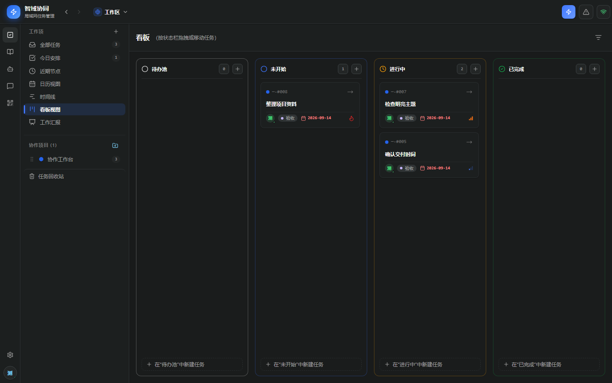

### 2. 现代任务卡片与列表视图（Task Cards & List View）
全新现代卡片排版与标准/紧凑密度自适应，直观展示编号、自定义状态药丸、优先级旗帜、负责人、起止排期、提前提醒与任务进度条；支持独立子工作项、检查清单与本地附件的内联展开与快速打卡，按工作区与项目记忆显示偏好。

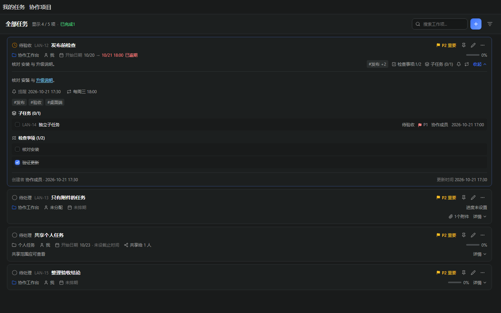

### 3. 半透明桌面日历挂件（Desktop Calendar Widget）
独立半透明桌面挂件窗口，支持贴附桌面底层（Pinned to Desktop）或始终置顶，深度融合农历、节气与法定调休，双击单元格快捷录入待办。


### 4. 月度日历排期（Calendar Schedule）
集中展示团队任务到期节点、循环任务未来排期与中国农历传统节假日。

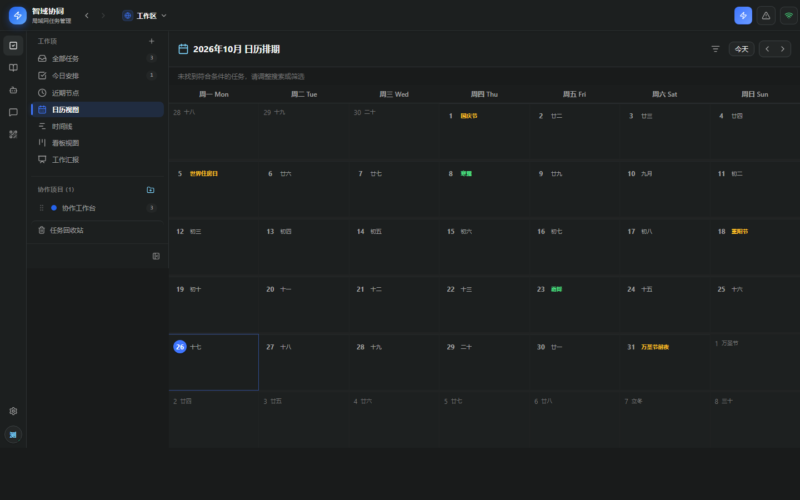

### 5. AI 工作汇报工作室（AI Report Studio）
一键汇总周期任务事实，借助大模型自动萃取关键成果与论点，支持直接导出规范精美的 16:9 PPTX 演示文档。

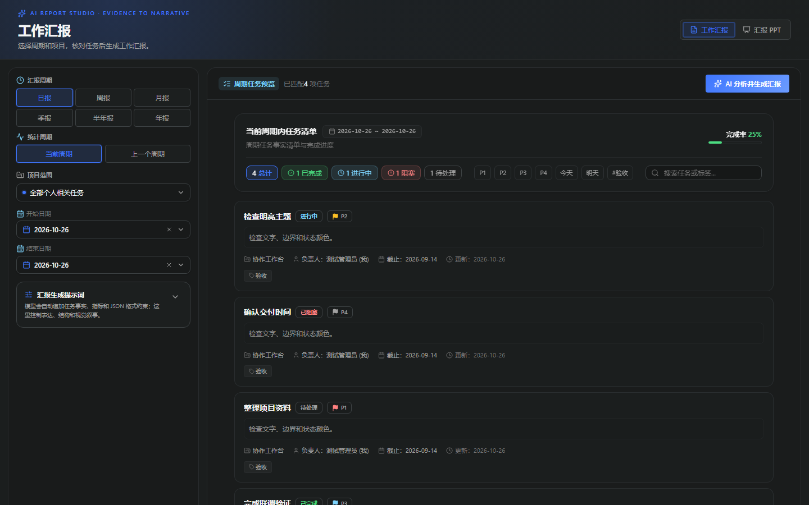

### 6. 系统全域配置中心（Settings & LLM）
支持私有化与 OpenAI 兼容大模型接入、在线拉取模型列表；提供桌面日历透明度/底色调节、提示音多音效试听、局域网 MCP 服务管理与本地数据安全清理。

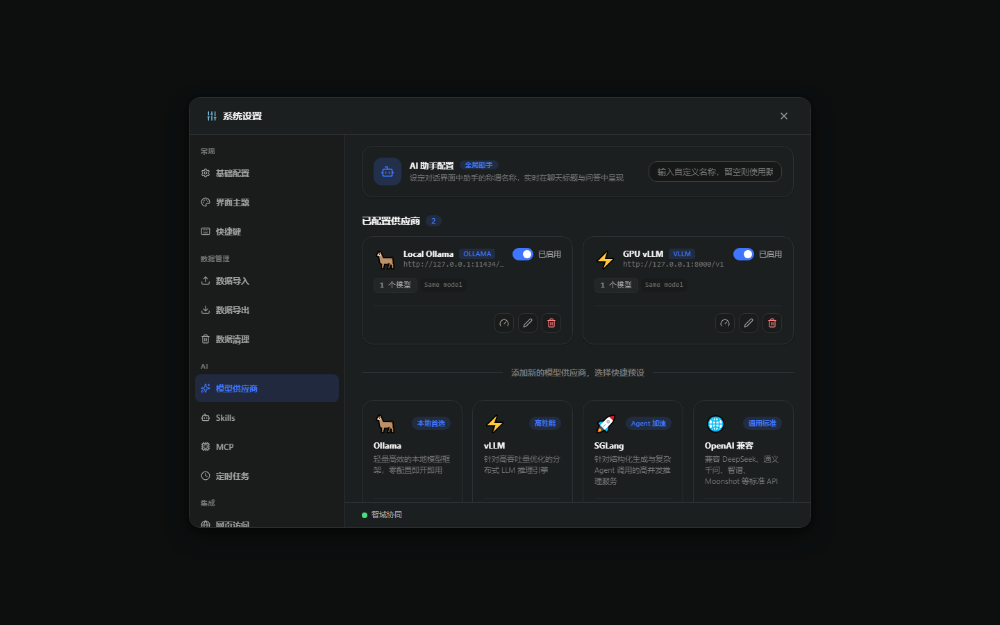

### 7. 局域网即时通讯（LAN Chat）
在同一局域网内直接进行全员广播、点对点会话、项目频道和自定义群组沟通。支持文字、图片、文件与桌面截图涂鸦标注，支持 `@` 成员提醒、任务引用与关联协作项目自动同步群组成员。

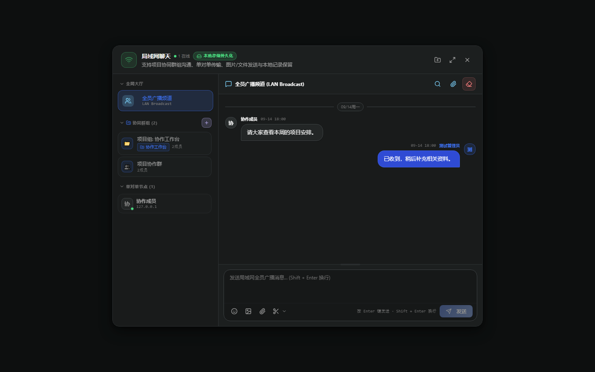

### 8. 光学文件传输（Optical Air-Gap Transfer）
面向断网、物理隔离和保密网络环境，通过发送端循环播放动态二维码，由另一台设备使用摄像头、图片或录像恢复文件；文件内容不上传网络，也不依赖下载链接。

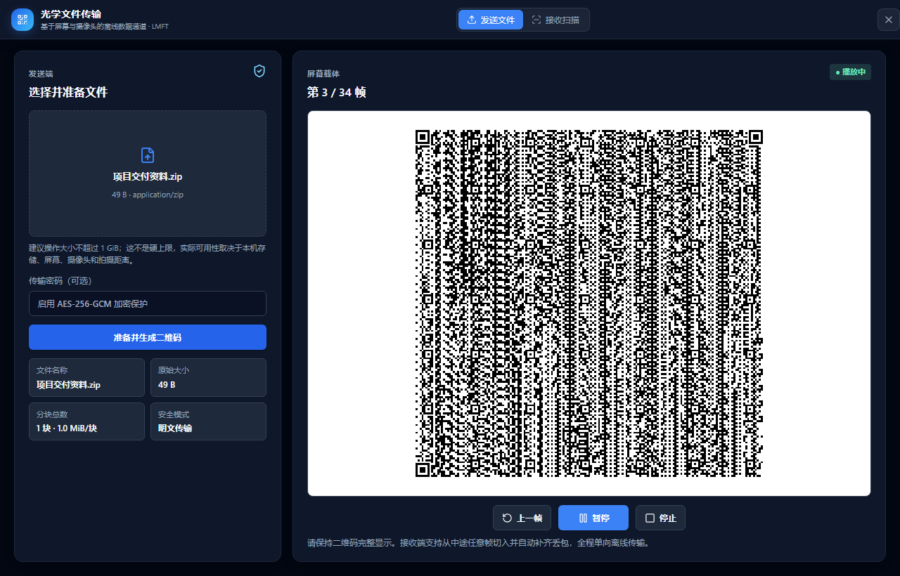

### 9. Notion 风格知识库与历史版本（Wiki Knowledge Base）
多层级树状文档、24 款页面 Emoji 图标选择器、呼吸感大标题与属性药丸栏；支持 Notion 标志性全宽铺满、居中阅读模式与分屏实时对照沉浸式写作。具备自动快照与历史版本对比恢复、未发布草稿备份恢复、协同讨论区引用评论，支持全量保留目录树与本地图片附件导出为 ZIP 压缩包。

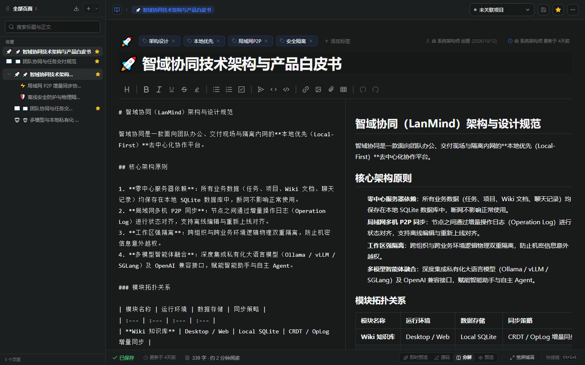

### 10. 多模型智能体与 AI 追问交互（AI Agent Workspace）
接入 Ollama / vLLM / SGLang / OpenAI 兼容接口等多模型供应商，支持实时流式增量响应、回答分支版本切换与本地文件 Agent。模型在执行复杂任务时可自主发起结构化追问卡片（支持分组单选、多选、说明补充与快捷提交），会话回复一键转化为任务待办或 Wiki 知识库，深度集成 MCP 客户端与工作区定时自动化任务。

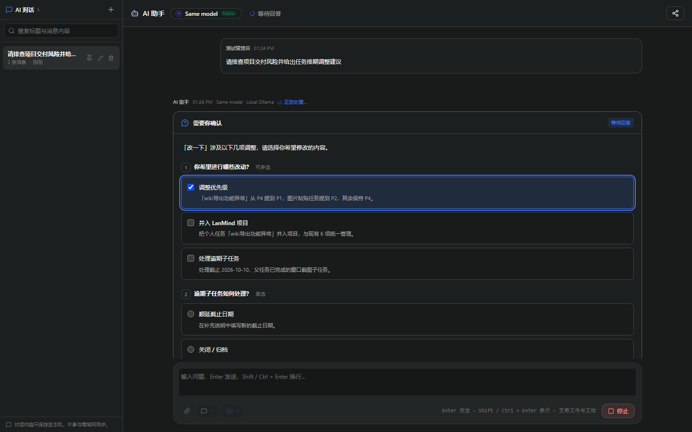

### 11. 组织架构与工作区隔离管理（Workspace Settings）
支持多工作区独立存储与数据沙箱隔离；提供多级组织架构树管理，支持一键全部展开/折叠，并与协作项目成员挑选、角色分配（管理员/成员/只读）及群聊人员实现层级联动。

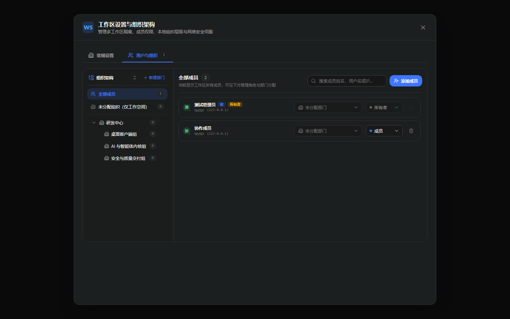

### 12. 任务回收站与安全防误删（Task Recycle Bin）
删除任务前统一安全确认，默认保留子任务并可勾选级联删除；删除后自动移入任务回收站保留 30 天。支持按关键字与所属项目快速检索、查看只读历史快照，提供单项一键恢复、同次删除整组级联恢复以及到期自动清理或彻底销毁保护。

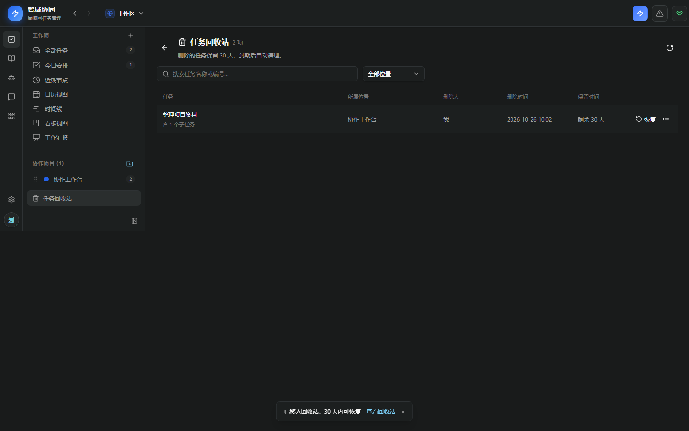

---

## 核心功能

### 任务管理
- 管理个人任务和项目任务，支持 P1-P4 优先级与项目自定义状态。状态归入待办池、未开始、进行中、已完成、已取消五类；阻塞是进行中组下的独立状态。
- 设置负责人、截止日期、具体时刻、提前提醒、标签和子任务清单。
- 我的任务和协作项目使用卡片列表，可切换标准/紧凑密度；独立子任务、检查事项和附件分区展开，任务进度与两类完成数量分别展示。
- 新建表单按需展开更多属性；编辑表单在宽屏并列展示正文和属性，窄屏通过页签切换。删除时显示任务名称并确认子任务处理方式，失败可重试。
- 任务回收站集中管理已删除任务，默认保留 30 天；支持多条件搜索、项目筛选、只读详情预览、单项恢复与整组恢复，保障协同数据安全。
- 使用全部任务、今日安排、近期节点、列表、看板和日历等视图组织工作。
- 按标题、描述、标签、优先级和状态快速搜索或筛选任务。
- 通过版本化 JSON 文件导入、导出当前账号可见的任务数据，重复任务不会覆盖本机记录。
- 新任务被指派时在应用内提示，主窗口隐藏或最小化时发送带微动效与声画同步的系统通知，支持 5/10/15/30 分钟稍后提醒。

### 循环任务
- 支持每天、每 N 天、每周指定一个或多个星期、每 N 周、每月指定日期、每 N 月、每年指定月日和每 N 年。
- 支持“每周一”“每周一至周五”“每两周的周一和周三”“每月 1 号”“每年 8 月 12 日”等日历规则。
- 循环规则可以绑定本地执行时刻（例如“每周一 08:00”），并沿用任务的提前提醒设置。
- 首次到期日期会自动对齐到最近的规则日期；每月 29-31 号及每年 2 月 29 日在无对应日期时按当月最后一天执行。
- 完成当前任务后生成下一条任务；逾期多期时跳到未来最近一期，不堆积已经错过的周期。
- 编辑当前循环任务会更新当前及后续规则，已完成的历史任务真实留痕。

### 桌面日历（桌面挂件）
- **跨平台桌面底层钉附**：
  - **Windows**: 采用 Win32 Shell Window 归属机制，`Win + D` 显示桌面不丢失、不遮盖；
  - **macOS**: 采用 Cocoa 运行时直接绑定 `kCGDesktopWindowLevel` 壁纸桌面层，跨 Spaces 虚拟桌面常驻，调整与交互时智能浮升；
  - **Linux**: 标准化 `set_always_on_bottom(true)` 与跳过任务栏；
- **农历与节假日体系**：支持农历月日、二十四节气、中国传统与法定节假日，以及调休/补班角标与悬浮详细提示。
- **个性化半透明底色配置**：支持“跟随应用主题”或“自定义颜色”（系统原生 1677 万色拾色器 + 6 款质感色卡），底色透明度 0%~100% 自由平滑调节，智能自适应前景文字明暗对比度。
- **快捷创建待办**：双击日历日期单元格弹出极简轻量录入弹窗；支持自然语言与 AI 智能语义分析；支持纯键盘极速盲打（`Enter` 保存，`Esc` 退出）。
- **桌面交互**：支持鼠标穿透（防误触）、自由拖拽移动与位置记忆、原生右键菜单（快捷锁定、图层切换、刷新、快捷设置等）。

### 项目与权限
- 创建局域网协作项目，设置项目说明、标识色、成员和项目管理员。
- 发现同一局域网中的可加入项目，通过申请和审批进入项目。
- 项目管理员负责成员审批与权限管理，不设置全局中心管理员。
- 项目任务可对全体项目成员共享，也可限制为创建者和负责人可见。

### 工作区与 Wiki
- 创建和切换本机工作区，维护工作区资料、时区、成员及本地组织目录；项目隶属工作区，状态可按项目单独配置。
- 工作区切换会使旧上下文请求和外部授权失效；从本机移除工作区不会广播删除其他设备的数据。
- Wiki 支持嵌套页面、全文搜索、Markdown 编辑/预览、项目关联和导出；收藏、展开与选择状态属于个人视图。
- 旧多工作区数据库首次迁移生成备份，不能判断归属的历史记录保留到隔离区，详见 [迁移记录](docs/WORKSPACE_ISOLATION_PLAN.md)。

### 局域网协作
- 自动发现局域网节点，展示在线状态，并保留暂时离线的成员身份。
- 通过增量操作日志同步项目、任务、成员资料和协作状态。

### 局域网即时通讯
- 提供全员广播、点对点单聊、项目频道和自定义协作群组，支持群公告、成员管理、管理员设置及群主转让。
- 发送文字、图片和文件消息；文件采用 1 MiB 分块传输，支持偏移续传、SHA-256 完整性校验和 ChaCha20-Poly1305 加密。
- 聊天记录保存在本机，支持会话内全文搜索、未读消息聚合、已读状态、消息引用、转发和从消息快捷创建任务。
- 支持聊天窗口最大化、图片预览和聊天文件集中查看；成员暂时离线后仍保留会话身份与本地历史记录。
- 用户旁的共享按钮可浏览对方实时共享的文件和目录；“我的共享”用于添加本机文件、目录和停止共享。目录下载保留层级和空目录，支持进度、取消与中断后续传。
- 共享仅限当前工作区，默认只读；目录可设为可写，允许上传新文件和新建目录，同名内容不会覆盖。单个文件最多 2 GB，共享者需保持应用运行。

### 光学文件传输
- 在没有网络连接或网络不允许跨域传输时，将文件内容编码为动态黑白二维码，通过屏幕和摄像头建立单向离线数据通道。
- 发送端支持 Zstandard 分块压缩和可选 AES-256-GCM 密码保护，二维码可暂停、继续、逐帧回看或从头播放。
- 接收端支持摄像头实时扫描，也可以导入二维码图片或录像；可从任意帧开始采集，并利用 RaptorQ/FEC 自动补齐丢包。
- 使用 CRC32C、SHA-256 和对象级校验阻止损坏数据生成最终文件，接收进度可持久保存并在应用重启后恢复。
- 提供可独立部署的离线 PWA 接收器，预缓存二维码识别、解码和解压所需资源，安装后可在断网环境运行。
- 协议与边界详见 [LMFT/1 协议规格](docs/OPTICAL_TRANSFER_PROTOCOL.md)。

### AI 工作能力
- 配置多条模型连接，每条维护多个模型；支持 Ollama、vLLM、SGLang 和 OpenAI 兼容接口预设，按连接分组选择模型。
- 对话、工作区 Agent、快速解析和报告分别设置默认模型；支持模型发现、连接参数与模型参数、聊天和原生工具调用测试，密钥通过系统保护存储。
- 多轮对话保存到本机 SQLite，支持停止生成、重新生成、回答版本切换、会话搜索及旧记录迁移；个人 AI 会话不参与局域网同步。
- 使用自然语言快速创建任务，自动提取标题、日期、时刻、优先级、项目、负责人、标签和结构化循环规则。
- 扫描逾期、阻塞和高优先级任务，集中展示风险与待处理事项。
- 基于真实任务记录生成日报、周报、月报、季度、半年或年度工作汇报。
- 将生成的汇报直接导出为规范精美的 16:9 PPTX 演示文档，支持选择或导入自定义主题。
- 工作区和文件 Agent 可调用业务工具、所选 Skills 及外部 MCP 工具。目录读取和创建需要授权，修改已有文件需要审批，并提供冲突检查、加密备份和恢复入口。
- 提取 PDF、DOCX、表格和文本附件，生成 TXT/Markdown/CSV/JSON/DOCX/XLSX；纯 JavaScript 在受限子进程中处理 JSON，不开放 Shell、网络或文件 API。
- 定时任务支持一次性、每小时、每天、每周，在应用运行、解锁且所属工作区为当前工作区时只读执行，结果保存为会话。

Agent 模型需要先通过工具调用测试。文档处理不包含 OCR、图像理解或原 Office 复杂排版的保真编辑；尚未完成真实推理部署的兼容性联调。配置步骤和限制见 [实施说明](docs/AI_AGENT_DELIVERY.md)。

### MCP Agent 接入
- **MCP Server**：向外部客户端提供 `get_context`、`list_users`、`list_projects`、`list_states`、`list_tasks`、`get_task`、`list_risk_warnings`、`create_task`、`update_task` 九项工具，不暴露删除任务或模型密钥。
- Server 使用启用时固定的工作区及用户授权，复用 SQLite 权限、版本冲突检查、操作日志和 P2P 同步；切换工作区后需重新配置授权。
- **MCP Client**：在 AI 设置中连接外部 Streamable HTTP 或可信 stdio 服务，发现并选择工具，按工具授予只读访问，其余操作进入审批。
- 配置、传输和信任边界见 [MCP 接入手册](docs/MCP.md)。

---

## 产品架构

智域协同采用本地优先的点对点架构。交互界面、桌面能力、本地数据库和网络通信共同打包在客户端内，不需要部署独立的中心业务服务。

```text
┌──────────────────────── 桌面客户端 (Windows / macOS / Linux) ───────────┐
│                                                                        │
│  任务 / 循环排期 / 项目 / 桌面日历 / 聊天 / 汇报界面                     │
│                    │                                                   │
│                    ▼                                                   │
│  桌面能力与业务编排 (Tauri 2)                                            │
│  窗口 · 托盘 · 快捷键 · 通知与提示音 · 权限校验 · 文件读写                │
│          │                                        │                    │
│          ▼                                        ▼                    │
│  SQLite 本地数据库                         局域网 P2P 通信               │
│  任务规则 · 业务数据 · 操作日志             节点发现 · 同步 · 聊天 · 文件   │
└──────────┬────────────────────────────────────────┬────────────────────┘
           │                                        │
           │ 加密增量同步                            │ 可选调用
           ▼                                        ▼
      其他 LanMind 节点                      OpenAI 兼容模型服务
```

### 应用分层

| 层 | 技术与位置 | 职责 |
| --- | --- | --- |
| 渲染层 | React 19、TypeScript、Vite，`lanmind/src/` | 工作台、Wiki、AI、任务、日历、聊天、主题与汇报界面 |
| 业务接口 | `lanmind/src/services/api.ts`、`components/ai/aiClient.ts` | 封装工作区上下文与 Tauri IPC；AI 生产功能需要桌面端，网络任务页使用 Rust HTTP 服务 |
| 桌面核心 | Tauri 2、Rust，`lanmind/src-tauri/src/lib.rs` | 命令注册、权限编排、窗口生命周期、托盘、快捷键、系统通知与 MCP 服务 |
| 数据层 | SQLite、`lanmind/src-tauri/src/db.rs` | 本地持久化、事务、权限过滤、风险扫描、汇报数据集和操作日志 |
| AI 运行时 | `lanmind/src-tauri/src/ai_*.rs` | 模型路由、会话与运行、原生工具循环、审批、文件、Skills、MCP 客户端、脚本及定时任务 |
| 网络层 | UDP/TCP、`lanmind/src-tauri/src/network.rs` | 节点发现、加密同步、聊天、邀请和文件分块传输 |
| 共享契约 | `lanmind/src/types.ts`、`models.rs` | TypeScript 与 Rust 的 camelCase JSON 数据结构 |

---

## 下载安装

稳定版请从 [GitHub Releases / v0.2.1](https://github.com/bspeng922/lanmind/releases/tag/v0.2.1) 下载对应平台的安装包。发布页中的 `<version>` 为 `0.2.1`，Tag 和 Release 名称带 `v` 前缀。

| 平台 | 推荐产物 | 说明 |
| --- | --- | --- |
| Windows | `LanMind_0.2.1_x64-setup.exe` | NSIS 安装向导，适合普通用户 |
| Windows | `LanMind_0.2.1_x64_en-US.msi` | 适合内网批量部署 |
| macOS Apple Silicon | `LanMind_0.2.1_aarch64.dmg` | M 系列芯片 |
| macOS Intel | `LanMind_0.2.1_x64.dmg` | Intel 芯片 |
| Linux | `lanmind_0.2.1_amd64.deb` | Ubuntu / Debian |
| Linux | `LanMind_0.2.1_amd64.AppImage` | 免安装便携运行 |

升级前请退出正在运行的旧版本。运行 `v0.2.1` 会自动迁移工作区、任务状态及 AI 配置和会话，建议在跨大版本前备份应用数据目录；相关迁移与回退说明见 [发布指南](RELEASE.md)。

---

## 快速上手与开发构建

### 环境要求

- **通用环境**：Node.js 22+ 与 Rust stable (2021 edition)
- **Windows**: Visual Studio C++ 生成工具 (MSVC) 与 WebView2
- **macOS**: Xcode 命令行工具 (`xcode-select --install`)
- **Linux (Ubuntu/Debian)**: `sudo apt install -y build-essential pkg-config libwebkit2gtk-4.1-dev libappindicator3-dev librsvg2-dev patchelf libssl-dev libxcb1-dev libxcb-randr0-dev libxrandr-dev libdbus-1-dev libpipewire-0.3-dev libwayland-dev libgbm-dev libegl-dev libegl1-mesa-dev libclang-dev`

### 本地启动与调试

进入工程目录 `lanmind/`：

```bash
cd lanmind
npm install
```

#### Windows:
```powershell
npm run desktop        # 启动桌面端开发模式（Tauri 2 + Vite 实时热重载）
npm run desktop:build  # 本地构建 Windows 安装包（NSIS .exe 与 .msi）
```

#### macOS / Linux:
```bash
npm run desktop:unix        # 启动桌面开发模式
npm run desktop:build:unix  # 本地构建安装包（.dmg / .app / .deb / .AppImage）
# 或直接运行: bash scripts/build-desktop.sh
```

#### 测试与质量检查：

首次运行浏览器用例前，先在 `lanmind/` 执行 `npx playwright install chromium`。

```bash
npm run check:i18n          # 生成并校验中英文语言资源
npm test                    # 前端单元测试
npm run test:i18n           # 国际化、日期格式和双语速记测试
npm run test:optical        # 光学传输核心算法测试
npm run test:task-content   # 任务正文、链接、检查项和副本测试
npm run test:ai-questions   # AI 追问解析、选项、文本回答与浏览器交互
npm run lint                # TypeScript 类型检查 (tsc --noEmit)
npm run build               # 构建前端与离线接收端生产资源
cd src-tauri && cargo test  # Rust 后端测试（SQLite、工作区、网络、MCP 与 AI；含默认跳过项）
```

AI 界面运行 `npx playwright test tests/theme/ai-agent.spec.ts`；任务卡片、删除确认、编辑器及 Wiki 历史的定向用例见 [测试手册](docs/TESTING.md)。工作区用例和原生脚本测试命令也在该手册中。浏览器 fixture 只验证界面，不能代替桌面数据库、推理服务和系统功能验收。

### 自动云端构建（GitHub Actions）

仓库已内置多平台 CI/CD 流水线 [`.github/workflows/release.yml`](.github/workflows/release.yml)：

- 完成版本更新与验收后推送新的 `v<version>` 标签，正式流程见 [发布指南](RELEASE.md)；已有 `v0.2.0`、`v0.2.1` 标签不重复创建；
- 矩阵环境自动并行运行 `windows-latest`、`macos-latest` (Apple Silicon & Intel) 与 `ubuntu-24.04`；
- 自动打包并在 GitHub Releases 生成全套发布物：
  - Windows: `*-setup.exe`, `*.msi`
  - macOS: `*.dmg`, `*.app`
  - Linux: `*.deb`, `*.AppImage`

流水线负责构建和发布，完整测试需事先执行；`workflow_dispatch` 用于明确选择引用后的手动构建。发布摘要当前对应 v0.2.1，后续发版需同步更新。

---

## 深入技术文档与项目规范

- [版本发布指南](RELEASE.md)：发版前检查清单、多平台构建命令与 GitHub CI/CD 自动化发版
- [更新日志](CHANGELOG.md)：版本演进历史与各版本更新详情
- [架构设计说明](docs/ARCHITECTURE.md)：数据模型、P2P 传输边界、同步语义与桌面生命周期
- [测试与验证手册](docs/TESTING.md)：单元测试、多节点联调、桌面回归与构建验证
- [LMFT/1 协议规格](docs/OPTICAL_TRANSFER_PROTOCOL.md)：二维码 packet、对象、压缩、加密与完整性规则
- [MCP 局域网生态](docs/MCP.md)：Model Context Protocol 工具规范与配置方式
- [多模型与 Agent 实施说明](docs/AI_AGENT_DELIVERY.md)：配置步骤、实现范围、验证结果和限制
- [工作区隔离记录](docs/WORKSPACE_ISOLATION_PLAN.md)：数据归属、迁移、网络协议和待验收事项
- [主题维护](lanmind/src/styles/themes/README.md)：亮暗主题、旧标识迁移和组件语义变量
- [仓库文件维护](docs/REPOSITORY_HYGIENE.md)：源码与锁文件保留、本地产物及运行数据忽略规则

---

## 开源协议

本项目采用 [MIT License](LICENSE) 开源协议。
